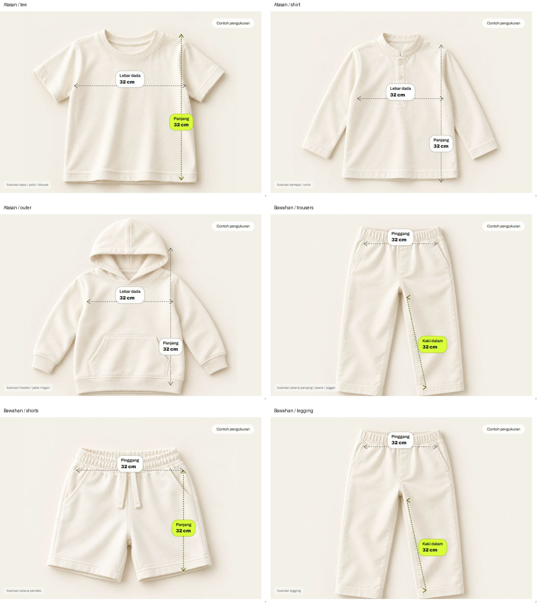
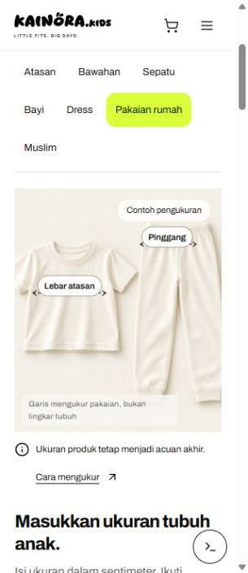
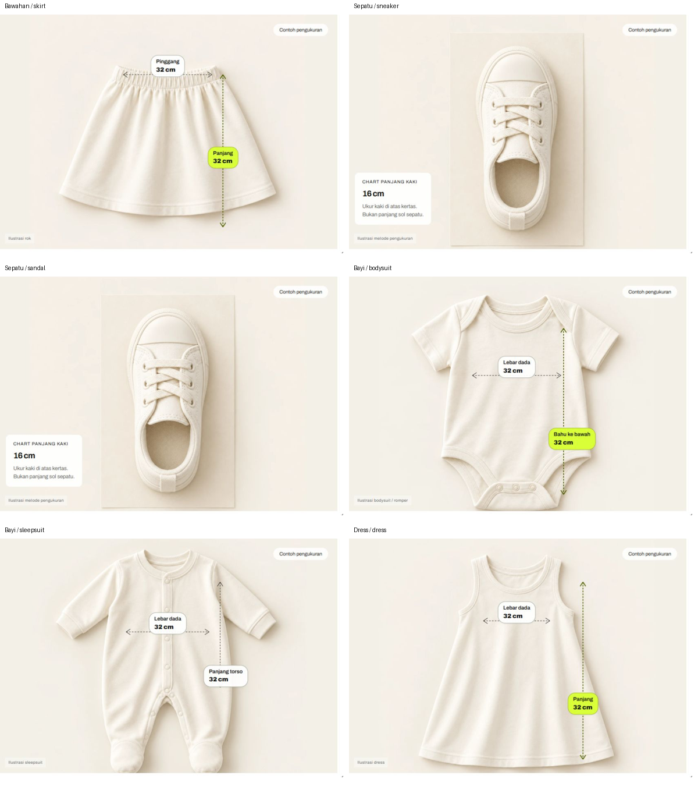
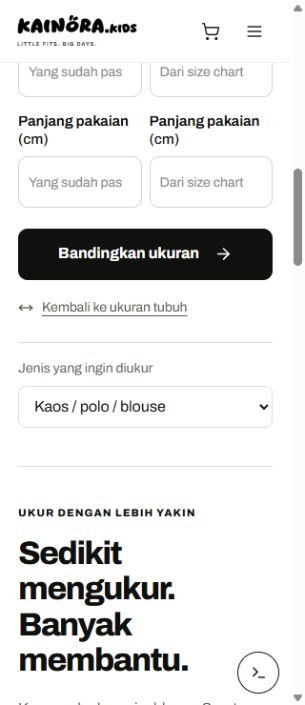

# Audit Studio Ukuran Kainora — 26 Oktober 2026

**Verdik: belum layak dinyatakan presisi.** Formulir dan aritmetika dasarnya berjalan, tetapi ilustrasi pengukuran, beberapa petunjuk, dan perpindahan langkah masih memiliki masalah yang terkonfirmasi. Audit ini tidak mengubah kode produk.

## Cakupan dan cara pembuktian

- Halaman: `http://127.0.0.1:5173/panduan-ukuran-anak/`.
- Tujuan pengguna: memahami titik ukur yang benar, mencatat ukuran tubuh, lalu membandingkan angka dengan size chart tanpa tertukar antara lingkar tubuh dan lebar pakaian.
- Audit gabungan fungsi, UX, visual dan sebagian aksesibilitas. Tidak menyatakan kepatuhan WCAG penuh.
- Semua bukti di bawah direkam pada sesi audit ini. Laporan QA lama tidak dipakai sebagai bukti kelulusan.
- 7 kategori, **21 jenis**; 21 × 2 mode × 2 kondisi layar = **84 simulasi browser** utama. Desktop 1440×1050 dan HP 390×844. Tambahan 7 kategori pada HP 320×740 menggunakan Enter.
- Uji lebar 320, 390, 768, 844 landscape, 1024; pengujian desktop utama 1440. Scrollbar mengurangi client width sebanyak 15 px. Itu sebabnya viewport 320 mempunyai area dokumen 305 px.
- **228 pemeriksaan batas input** minimum/maksimum dan nilai di luar batas: tidak ditemukan kegagalan pada model. **10/10 tes fitur yang ada lolos**. Ini tidak membuktikan ketepatan titik panah maupun kecocokan pakaian nyata.
- Tidak melakukan deploy, push, perubahan katalog, backend, database, atau perbaikan source code. Server Vite dinyalakan kembali agar audit aset bisa berlangsung.

## Langkah audit dan kesehatan tiap langkah

1. **Masuk ke halaman / keadaan awal — berfungsi.** Navbar Panduan Ukuran dan formulir tersedia. Bukti: [keadaan awal](01-default-desktop.png).
2. **Pilih kategori dan jenis — berfungsi dengan ketidaksesuaian visual.** Seluruh 21 pilihan dipilih langsung dan gambar berhasil dimuat setelah server aktif. Beberapa jenis masih menggunakan aset jenis lain. Bukti: `live-*.png` dan [matriks browser](browser-simulations-live.json).
3. **Masukkan ukuran tubuh — perhitungan berjalan, fungsi rekomendasi belum tersedia.** Hasil mengulang ukuran yang dimasukkan beserta catatan. Tidak menghasilkan label S/M/L/EU. Bukti: [hasil HP](04-mobile-body-result.png).
4. **Input kosong/salah dan perbaikan input — sebagian bermasalah.** Submit menolak input salah dan memfokuskan kolom pertama. Namun memperbaiki satu kolom menghapus error kolom lain yang masih kosong. Bukti: [rekaman validasi](validation-clear.json).
5. **Bandingkan size chart — aritmetika berjalan, visual belum lengkap.** Kasus lebih besar, sama dan lebih kecil teruji. Panah hanya menampilkan nilai chart kanan, walaupun kolom pembanding kiri sedang aktif. Bukti: [nilai pembanding](08-reference-value-mismatch.png), [matriks HP](mobile-all-types.json).
6. **Lanjut dari hasil ke mode banding — bermasalah di HP.** Awal formulir tertinggal di atas layar dan fokus menjadi BODY. Bukti: [setelah lanjut banding](05-mobile-switch-compare.png).
7. **Panduan gambar dan cutting — bermasalah.** Titik ukur tidak terkalibrasi per aset; beberapa ukuran tidak punya penanda. Bukti: empat lembar visual di bawah.
8. **HP, tablet dan landscape — struktur tidak overflow, gambar masih dapat terpotong.** Input 16 px dan submit Enter bekerja; area ilustrasi pada HP kecil dapat lebih lebar dari wadah dan label bisa bertumpuk. Bukti: [pengukuran tabrakan](mobile-collisions.json), [metrik responsif](responsive-metrics.json).
9. **Runtime dan sumber — tidak ditemukan exception aplikasi setelah server aktif; verifikasi sumber terbatas.** Query console sesi aktif kosong. Sumber resmi diperiksa terpisah di bawah; H&M dibatasi 403, bukan dianggap tautan mati.

## Temuan menurut prioritas

### F01 — P1: titik awal/akhir panah tidak mengikuti metode ukur dan aset

**Terbukti di layar dan kode.**

- Kaos: garis panjang berada jauh di sisi kanan, bukan ditambatkan pada bahu dekat kerah seperti petunjuk halaman.
- Hoodie: memakai profil `shirt`, sehingga garis panjang mulai di area kap/kepala, bukan bahu dekat kerah; lebar dada juga tidak tepat mengikuti kedua sisi badan pakaian.
- Bodysuit: penanda torso berada di sisi kanan, bukan menghubungkan bahu dekat leher ke selangkangan; teksnya berubah menjadi “Bahu ke bawah”, sementara kolom meminta “Bahu ke selangkangan”.
- Rok: garis panjang melewati ujung kain. Mukena: garis atasan mulai di sekitar sisi bukaan wajah, padahal instruksi meminta dari atas kepala. Dress/gamis mempunyai posisi bahu/hem berbeda tetapi memakai profil garis sama.
- Inseam celana tidak mengikuti jalur jahitan bagian dalam.

**Penyebab:** `src/components/size-guide/MeasurementStage.jsx:5` menyimpan koordinat tetap per `diagram`. Pemilihan gambar pada baris 24–26 dapat mengganti aset tanpa mengganti profil titik yang khusus untuk aset tersebut. Fit kaos Regular/Relaxed/Oversize pun memakai koordinat tee yang sama. Bukan masalah pembulatan angka.

**Dampak:** orang tua dapat meniru lokasi ukur yang salah, walaupun pengurangan angka hasilnya benar.

**Perbaikan yang disarankan:** profil pengukuran per aset + per cutting, dengan titik ukur didefinisikan sesuai metode yang tertulis. Kalibrasi pada gambar asli, lalu simpan koordinat normalisasi. Untuk garis di luar kain, gunakan garis bantu yang benar-benar menghubungkan titik awal/akhir ke kain. Jangan menggeser panah semua jenis dengan satu offset global.

### F02 — P2: kepala panah diagonal tidak mengikuti arah garis

**Terbukti:** inseam celana berupa diagonal, tetapi bentuk kepala panah diperlakukan seperti panah horizontal.

**Penyebab:** `MeasurementStage.jsx:40` hanya membedakan `x1 === x2` (vertikal) dan selain itu (dianggap horizontal). Tidak ada perhitungan sudut diagonal.

**Perbaikan:** gunakan SVG marker yang berorientasi mengikuti garis (`orient="auto-start-reverse"`) atau hitung vektor arah dan normalnya. Verifikasi kepala di kedua ujung pada garis mendatar, tegak dan diagonal.

### F03 — P2: dimensi yang diminta form belum semuanya dijelaskan visual

**Terbukti:** dari 18 jenis non-alas-kaki, **13 jenis** memiliki setidaknya satu dimensi pembanding tanpa penanda visual.

- Kemeja, hoodie, koko: panjang lengan.
- Celana panjang, pendek, legging, rok: lebar pinggul.
- Sleepsuit, jumpsuit: inseam.
- Dress, gamis: lebar pinggang.
- Piyama: panjang atasan.
- Hijab: lingkar bukaan wajah.

Sepatu, sandal dan kaus kaki juga tidak mempunyai diagram panjang kaki; hanya kartu teks. Ini keputusan yang lebih aman daripada menggambar panjang sol sebagai panjang kaki, tetapi belum memenuhi kebutuhan tutorial visual panjang kaki. Daftar mentah “missing” mencakup ketiganya; angka 13 di atas sudah mengecualikannya.

**Penyebab:** `type.dimensions` pada model dan `diagrams` pada komponen adalah dua daftar terpisah tanpa pemeriksaan kelengkapan. Tes lama hanya memeriksa bahwa fields/instructions tersedia, bukan bahwa seluruh dimensi punya metode visual.

**Perbaikan:** satu definisi dimensi yang juga merujuk profil visual. Tambahkan pemeriksaan cakupan, serta panel ukur yang aktif per dimensi agar semua garis tidak ditumpuk sekaligus. Untuk kaki gunakan visual kaki di atas kertas, bukan panjang sepatu.

### F04 — P2: gambar HP kecil terpotong dan label pinggang tertutup tag

**Terbukti pada viewport 320×740:** client width 305, stage width 267, art plane width **315**. Ilustrasi lebih lebar 48 px daripada wadah. Screenshot memperlihatkan sebagian lengan kaos/koko dan sisi setelan piyama terpotong. Desktop juga memotong ujung beberapa pakaian panjang.

Label `Pinggang` celana bertumpuk dengan tag `Contoh pengukuran`; area tabrakan DOM sekitar **288 px²** pada reproduksi. Tag memiliki z-index lebih tinggi.

**Penyebab:** `src/pages/size-studio.css` memakai art plane persegi berdasarkan **tinggi** stage, sementara stage memakai `overflow:hidden`. Pada desktop tinggi art plane 118% dengan top -5%; pada mobile tingginya 100% tetapi tidak dibatasi lebar stage. Label/tag tidak punya penghindaran tabrakan.

**Perbaikan:** batasi bidang gambar ke sisi terkecil area yang tersedia dengan margin aman per aset; koordinat gambar dan anotasi tetap memakai bidang yang sama. Sisihkan zona tag, caption dan label. Uji gambar serta label, bukan hanya `scrollWidth === clientWidth`.

### F05 — P2: ilustrasi tidak selalu sesuai pilihan jenis

**Terbukti:** Singlet menampilkan kaos berlengan, Sandal/clogs menampilkan sneaker, Legging menampilkan celana lebar. Disclaimer “ilustrasi” tidak menjelaskan bahwa bentuknya mewakili jenis lain. Alt text dibentuk dari pilihan jenis sehingga dapat menyebut sandal ketika gambar sebenarnya sneaker.

**Penyebab:** fallback `type.asset || category.asset` serta pemetaan asset pada `src/content/sizeStudio.js:38`, `:40`, `:46`; alt text di `MeasurementStage.jsx` menggunakan `type.label`, bukan deskripsi aset.

**Perbaikan:** aset yang sesuai struktur jenis, atau label jelas “contoh pengukuran celana” dengan alt sesuai gambar. Untuk singlet dan sandal, buat visual khusus. Jangan menyebut aset sebagai jenis yang bukan tergambar.

### F06 — P2: petunjuk dan catatan hasil masih terlalu generik

**Terbukti dari hasil browser tiap jenis:**

- Pakaian dalam memakai instruksi “ukur bagian atasan dan bawahan” serta dada, walaupun fields-nya pinggang/pinggul.
- Hasil hijab/mukena/pakaian dalam masih menyertakan pernyataan tentang lingkar dada yang tidak relevan dengan semua jenis.
- Sepatu mendapat catatan “bukan jaminan pakaian akan pas” dan “potongan”; kaus kaki memakai kartu “bukan panjang sol sepatu”.
- Form sleeve/inseam/torso tidak mempunyai petunjuk pembanding yang spesifik; fallback help adalah “Ukur dalam keadaan dibentangkan ... Lebar berbeda dari lingkar.”
- Copy menyebut “angka negatif”, padahal UI menampilkan “2 cm lebih kecil”, bukan angka bertanda minus.

**Penyebab:** penggunaan ulang `homeSteps`, `topSteps`, `footSteps` dan hasil notes global (`src/content/sizeStudio.js:27–32`, `:67`; `src/utils/sizeStudio.js:42–47`).

**Perbaikan:** petunjuk per dimensi, mode dan jenis; hindari mencampur lebar baju, lingkar tubuh, torso, panjang kaki, panjang sol dan panjang kaus kaki.

### F07 — P2: CTA lanjut banding kehilangan fokus dan tidak membawa ke awal form

**Reproduksi:** HP 320, isi tinggi 110/dada 56 → submit → tekan “Lanjut bandingkan dengan size chart”. Form mulai sekitar **y=-147 px**, scroll sekitar 1152, fokus menjadi `BODY`; judul dan baris pertama berada di atas navbar/layar.

**Penyebab:** `SizeStudioView.jsx:38` hanya mengubah mode, mengosongkan hasil dan focused; elemen tombol hasil ikut dihapus. Tidak ada fokus/scroll ke awal form setelah render mode baru.

**Perbaikan:** fokuskan heading form atau kolom pertama sesudah mode berubah, dengan scroll margin navbar dan dukungan reduced motion. Fokus heading tidak perlu membuka keyboard virtual sebelum pengguna siap.

### F08 — P2: memperbaiki satu kolom menyembunyikan error kolom lain

**Reproduksi:** kosongkan tinggi dan dada → submit (dua error) → isi tinggi 110. Error dada hilang dan `aria-invalid` berubah false, walaupun dada masih kosong. Submit berikutnya baru memunculkannya lagi.

**Penyebab:** handler `onChange` memanggil `clearResult()`, yang menjalankan `setErrors({})` untuk seluruh form (`SizeStudioView.jsx:29`, `:52`).

**Perbaikan:** pisahkan reset hasil dari reset error. Revalidasi/hapus error hanya pada field yang diedit; pertahankan error field lainnya sampai valid. Sampaikan error per field melalui aria-describedby seperti implementasi saat submit.

### F09 — P2: nilai visual tidak mengikuti sisi kolom yang sedang disorot

**Reproduksi:** pembanding lebar 30, chart 32 → fokuskan kolom kiri. Panah disorot tetapi label tetap **32 cm**, bukan 30 cm, tanpa penjelasan “chart pilihan” pada label.

**Penyebab:** `stageMeasurements` hanya membuat `garmentValues` dari prefix `chart_` (`src/utils/sizeStudio.js:19`). Highlight di komponen menerima kedua prefix ref/chart berdasarkan akhiran id, tetapi angka tidak membedakan sisi aktif (`MeasurementStage.jsx:30`, `:44`).

**Perbaikan:** labeli nilai visual secara eksplisit sebagai chart, atau ikuti sisi aktif dengan identitas “Pembanding / Chart”. Jangan mengubah ukuran tubuh menjadi lebar pakaian otomatis.

## Kekurangan produk yang terpisah dari bug

**Belum ada kalkulator rekomendasi ukuran universal.** Body mode adalah catatan input; compare mode menghitung selisih. Tidak ada model rekomendasi dari BB/TB menjadi S/M/L atau ukuran sepatu. Berat badan sengaja tidak memengaruhi hasil. Ini terlihat dari output browser dan kode, bukan error runtime.

Keterbatasan itu sudah dijelaskan pada halaman, sehingga tidak tepat menyebut hasilnya rekomendasi ukuran yang akurat. Jika sasaran akhirnya rekomendasi, perlu dataset tervalidasi dan pengujian fit; tidak cukup mengalikan ukuran tubuh atau menganggap setiap merek beda 1–2 cm.

## Yang terbukti bekerja

- Semua kategori dan subtype dapat dipilih; 21/21 aset pada simulasi aktif termuat, beberapa memang aset representatif yang tidak tepat jenisnya.
- Seluruh 84 skenario utama menghasilkan output tanpa error field yang tidak diharapkan. Ini menguji eksekusi, bukan kebenaran fit atau titik ukur.
- Body mode menampilkan angka input; sepatu memakai kaki yang lebih panjang. Angka koma diterima, negatif/nonangka/kosong ditolak saat submit.
- Kasus 30→32/40→42 memberi selisih +2; HP juga memeriksa nilai sama dan foot 15→14 (lebih kecil). Perubahan input membuang hasil lama.
- Hasil menerima fokus setelah submit. Enter bekerja pada seluruh 21 jenis di HP.
- Tidak ada horizontal overflow dokumen pada ukuran layar yang diuji. Semua input yang diperiksa berukuran 16 px. Ini tidak berarti semua gambar utuh (lihat F04).
- Tautan Cara mengukur menuju bagian instruksi, tautan Size chart khusus Kainora membuka chart, dan Back kembali ke Studio telah dicoba. Satu main landmark terdeteksi, bukan main bertumpuk. Query console error/warn setelah server kembali aktif kosong: [console.json](console.json).
- Model tidak memakai LLM/API untuk menghitung ukuran; fungsi pengukuran dan perbandingan berjalan lokal.

## Tinjauan sumber resmi

- [UNIQLO Indonesia](https://www.uniqlo.com/id/id/special-feature/cp/kids-baby/size-guide): dapat dibaca pada audit; ada panduan pengukuran tubuh/pakaian dan kalkulator mereknya sendiri. Bukan bukti rata-rata semua cutting Indonesia.
- [adidas UAE](https://www.adidas.ae/en/size-chart-kids.html): dapat dibaca; menyediakan chart heel-toe dan cara ukur. Situs regional UAE sudah diungkap di halaman Kainora.
- [ISO 8559-2:2025](https://www.iso.org/standard/85590.html): halaman publik sesuai judul indikator dimensi ukuran pakaian berbasis tubuh. Bukan tabel rata-rata nasional Indonesia dan bukan validasi algoritma Kainora. Dokumen standar berbayar penuh tidak dibeli/dibaca.
- [H&M Indonesia](https://id.hm.com/id_id/customer-service/sizeguide/kids.html): akses pemeriksa web mendapat 403. **Belum terverifikasi isinya pada audit ini; tidak dinyatakan sebagai broken link.**

## Prioritas perbaikan yang konkret

1. Definisikan metode ukur setiap dimensi, lalu kalibrasi titik per aset/cutting; perbaiki kepala panah diagonal.
2. Lengkapi dimensi visual yang hilang dengan tampilan satu ukuran aktif, termasuk ilustrasi kaki di kertas.
3. Perbaiki skala berdasarkan lebar **dan** tinggi; tata ulang zona label/tag untuk 320–390 px dan tablet landscape.
4. Perbaiki fokus/scroll setelah mode berubah dan validasi per field.
5. Cocokkan gambar, alt, petunjuk dan hasil dengan setiap jenis; jelaskan sisi nilai visual.
6. Baru lakukan visual regression serta uji pengguna terhadap cara mereka benar-benar mengukur. Tetapkan keberhasilan yang memeriksa endpoint, label collision dan kelengkapan dimensi—bukan jumlah tes unit saja.

## Batas audit

- Data input adalah simulasi, tidak berasal dari anak/pembeli nyata. Tidak ada uji mencoba pakaian nyata.
- Browser desktop yang diubah viewport, bukan seluruh HP fisik. Keyboard virtual, iOS Safari/Android nyata, pembaca layar penuh dan pengaturan reduced motion OS belum diuji langsung. Dukungan reduced motion terlihat di source, tidak diklaim terbukti lewat toggle OS.
- Tidak menjalankan benchmark performa/CWV atau pengujian keamanan seluruh website.
- Pada awal audit server 5173 tidak mendengarkan. Tab lama masih menampilkan shell dari sesi sebelumnya tetapi gambar baru gagal dimuat. Setelah Vite dinyalakan, audit 84 skenario diulang dari fresh reload. Kegagalan awal dipisahkan sebagai masalah lingkungan.
- File `stage-*.png` dari percobaan capture clip pertama **ditolak** karena browser mengambil area/crop yang keliru; jangan dipakai sebagai bukti visual. `fit-Relaxed.png` dan `fit-Oversize.png` sempat tertangkap ketika garis masih dianimasikan; gunakan bukti stabil `stable-fit-*` untuk menilai endpoint. Bukti utama memakai `live-*.png`, `mobile-*.png` serta capture bernomor yang diperiksa. Contact sheet hanya crop/penataan screenshot asli untuk membantu membaca; tidak menggambar ulang UI.

Penilaian kelulusan pada QA sebelumnya terlalu longgar untuk ketepatan pengukuran: pengujian model dan overflow belum mencakup endpoint panah, gambar terpotong, collision label, dan kelengkapan tiap dimensi. Temuan audit saat ini menjadi acuan masalah terbuka.

Status audit: **selesai; perlu perbaikan sebelum lulus pemeriksaan presisi.** Tidak ada perbaikan source yang diterapkan dalam audit ini. Viewport override telah di-reset, input simulasi dikosongkan melalui navigasi baru, dan halaman Studio tetap terbuka.

## Matriks simulasi per jenis

Tabel berikut dibuat dari hasil browser yang direkam pada sesi ini. “Berjalan” berarti menghasilkan output tanpa error input; tidak berarti ukuran atau panah sudah benar.

| Kategori / jenis | Desktop tubuh / banding | HP tubuh / banding | Penanda yang belum ada |
|---|---|---|---|
| Atasan — Kaos / polo / blouse | Berjalan / berjalan | Berjalan / berjalan | Tidak ada dimensi yang hilang; posisi tetap perlu diperiksa |
| Atasan — Kemeja / tunik | Berjalan / berjalan | Berjalan / berjalan | Panjang lengan |
| Atasan — Hoodie / jaket ringan | Berjalan / berjalan | Berjalan / berjalan | Panjang lengan |
| Bawahan — Celana panjang / jeans / jogger | Berjalan / berjalan | Berjalan / berjalan | Lebar pinggul |
| Bawahan — Celana pendek | Berjalan / berjalan | Berjalan / berjalan | Lebar pinggul |
| Bawahan — Legging | Berjalan / berjalan | Berjalan / berjalan | Lebar pinggul |
| Bawahan — Rok | Berjalan / berjalan | Berjalan / berjalan | Lebar pinggul |
| Sepatu — Sepatu sekolah / sneaker / olahraga | Berjalan / berjalan | Berjalan / berjalan | Tidak ada panah kaki; hanya kartu angka |
| Sepatu — Sandal / clogs | Berjalan / berjalan | Berjalan / berjalan | Tidak ada panah kaki; hanya kartu angka |
| Bayi — Bodysuit / romper | Berjalan / berjalan | Berjalan / berjalan | Tidak ada dimensi yang hilang; posisi tetap perlu diperiksa |
| Bayi — Sleepsuit | Berjalan / berjalan | Berjalan / berjalan | Panjang kaki dalam |
| Dress — Dress | Berjalan / berjalan | Berjalan / berjalan | Lebar pinggang |
| Dress — Jumpsuit / playsuit | Berjalan / berjalan | Berjalan / berjalan | Panjang kaki dalam |
| Pakaian rumah — Piyama / setelan rumah | Berjalan / berjalan | Berjalan / berjalan | Panjang atasan |
| Pakaian rumah — Singlet | Berjalan / berjalan | Berjalan / berjalan | Tidak ada dimensi yang hilang; posisi tetap perlu diperiksa |
| Pakaian rumah — Pakaian dalam | Berjalan / berjalan | Berjalan / berjalan | Tidak ada dimensi yang hilang; posisi tetap perlu diperiksa |
| Pakaian rumah — Kaus kaki | Berjalan / berjalan | Berjalan / berjalan | Tidak ada panah kaki; hanya kartu angka |
| Muslim — Koko | Berjalan / berjalan | Berjalan / berjalan | Panjang lengan |
| Muslim — Gamis | Berjalan / berjalan | Berjalan / berjalan | Lebar pinggang |
| Muslim — Hijab instan | Berjalan / berjalan | Berjalan / berjalan | Lingkar bukaan wajah |
| Muslim — Mukena | Berjalan / berjalan | Berjalan / berjalan | Tidak ada dimensi yang hilang; posisi tetap perlu diperiksa |
